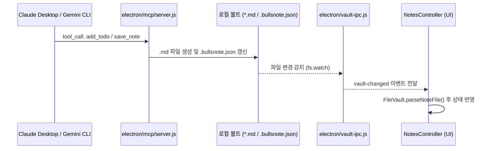

# BullsNote — 아키텍처 설계 문서

이 문서는 BullsNote(v2.0.1 기준)의 전체 시스템 아키텍처, MVC 계층 구조, 데스크톱(Electron) 및 웹(PWA) 듀얼 런타임 구성, 그리고 외부 연동 흐름을 정의합니다.

---

## 1. 핵심 설계 원칙

- **MVC 분리:** 도메인 규칙(`src/model/`)은 UI 프레임워크와 무관한 순수 TypeScript 함수·서비스로 유지하며 Vitest로 검증합니다. 상태 및 유스케이스 조합은 `NotesController`(`src/controller/`)가 담당하고, 화면(`src/view/`)은 컨텍스트를 구독해 렌더링만 수행합니다.
- **로컬 퍼스트 & 무서버(Serverless):** 모든 노트와 할일은 로컬(데스크톱 `.md` 파일 볼트 또는 브라우저 저장소)을 1차 저장소로 사용합니다. 로그인 없이 바로 동작하며, 다중 기기 동기화가 필요할 때만 사용자 본인의 Google Drive를 원격 저장소로 연결합니다.
- **노트-할일 통합 모델:** 할일(Todo)은 별도 DB가 아닌 `Note` 엔티티의 메타데이터(`isTodo`, `todoStatus`, `dueDate`, `startDate`, `reminderAt` 등)로 표현되며, 원 노트의 체크박스와 양방향으로 동기화됩니다.

---

## 2. 전체 시스템 구성도

```mermaid
flowchart TB
    subgraph Clients["클라이언트 런타임"]
        Desktop["Desktop App\n(Electron 44 + Tray + Local File Vault)"]
        PWA["Mobile / Web PWA\n(Service Worker + Browser Storage)"]
    end

    subgraph View["View Layer (src/view/ — React 18 + Mantine 7 + BlockNote 0.55)"]
        Today["TodayView · DailyNotePanel\n· TodayBriefingCard"]
        Todos["TodosView (목록 · 보드 · 타임라인)\n· PlannerView"]
        Editor["NoteEditorView · QuickCaptureModal\n· Mobile Views"]
    end

    subgraph Controller["Controller Layer (src/controller/)"]
        NC["NotesController.tsx\n(useNotes Context · 상태 · 자동저장 · 동기화 스케줄러)"]
    end

    subgraph Model["Model Layer (src/model/ — 순수 규칙 & 서비스)"]
        Domain["Note · TodoService · PlannerService\n· TaskQueryService · DailyNoteService"]
        Parsing["QuickCaptureParser · AiCaptureParser\n· HashtagService · SearchService · FileVault"]
        ExtSvc["GoogleDriveService · GoogleCalendarService\n· GoogleTasksService · GeminiService · TodayBriefing"]
    end

    subgraph ElectronMain["Electron Main & IPC (electron/)"]
        MainProc["main.js · tray.js · ipc-guard.js"]
        VaultIPC["vault-ipc.js\n(로컬 .md 파일 감시/읽기/쓰기)"]
        AuthIPC["google-auth-ipc.js\n(Desktop OAuth Loopback)"]
        MCP["mcp-ipc.js & electron/mcp/server.js\n(Stdio MCP Server)"]
    end

    subgraph Storage["저장소 & 외부 연동"]
        LocalFS[("로컬 볼트 (~/Documents/BullsNote)\n*.md + .bullsnote.json + assets/")]
        Drive[("Google Drive\n(증분 동기화 · QR/BNM1 페어링)")]
        CalTasks["Google Calendar & Tasks"]
        Gemini["Google Gemini API"]
        AIHost["Claude Desktop / Gemini CLI"]
    end

    Clients --> View
    View -->|액션 호출 / 상태 구독| NC
    NC --> Domain
    NC --> Parsing
    NC --> ExtSvc

    NC -->|Electron IPC (preload.js)| MainProc
    MainProc --> VaultIPC
    MainProc --> AuthIPC
    MainProc --> MCP

    VaultIPC --> LocalFS
    ExtSvc --> Drive
    ExtSvc --> CalTasks
    ExtSvc --> Gemini
    AIHost <-->|stdio JSON-RPC| MCP
    MCP -->|볼트 .md 직접 읽기/쓰기| LocalFS
```

---

## 3. 계층 및 모듈 상세

| 계층 | 경로 | 책임 |
|---|---|---|
| **Model** | `src/model/` | `Note` 타입/트리/정렬, `TodoService`(체크리스트 ↔ 할일 양방향 동기화), `PlannerService`(근무일·공휴일 기반 기간 계산), `DailyNoteService` & `TodayBriefing`(일일 노트·AI 브리핑), `QuickCaptureParser` & `AiCaptureParser`(자연어 날짜/시각/태그 파싱), `FileVault`(Markdown frontmatter 직렬화/역직렬화 및 에셋 변환) |
| **Controller** | `src/controller/NotesController.tsx` | 앱 전역 상태 관리, 노트 CRUD 및 히스토리(최대 30개) 스냅샷, 로컬 볼트 파일 변경 감지 반영, Google Drive/Calendar/Tasks 동기화 오케스트레이션 |
| **View** | `src/view/` | `TodayView`(오늘 할일·일정·기간 작업·브리핑), `TodosView`(목록·칸반 보드·간트 타임라인), `NoteEditorView`(BlockNote + Shiki 코드 강조 + 목차), `QuickCaptureModal`, `mobile/` 반응형 레이아웃 |
| **Electron Shell** | `electron/` | 단일 인스턴스 락, 트레이 백그라운드 상주, `ipc-guard.js` 및 `app-origin.js` 기반 IPC/Origin 보안 검증, `vault-ipc.js` 파일시스템 연동, `google-auth-ipc.js` OAuth 처리 |
| **MCP Server** | `electron/mcp/` | 외부 의존성 없는 Node.js stdio MCP 서버 (`save_note`, `list_projects`, `add_todo`, `list_today`). 데스크톱 앱과 동일한 `.md` 볼트 및 `.bullsnote.json` 포맷을 공유 |

---

## 4. 주요 데이터 흐름

### 4-1. 데스크톱 볼트 & 외부 AI(MCP) 공유 구조


### 4-2. 다중 기기 동기화 (Desktop ↔ PWA)
- **데스크톱 → 모바일 페어링:** Google Drive 연결 후 생성되는 QR 코드 또는 `BNM1:` 연동 코드를 PWA에서 스캔/입력하면 동일한 Google Drive 앱 폴더에 연결됩니다.
- **증분 동기화:** `GoogleDriveService`가 변경된 노트(`updatedAt` 및 리비전 비교)와 첨부 에셋만 업로드·다운로드하여 네트워크 전송량을 최소화합니다.
- **알림 연동:** `GoogleCalendarService`를 통해 알림 시각이 설정된 할일을 Google Calendar 이벤트로 동기화하여 모바일 푸시 알림을 보조합니다.
