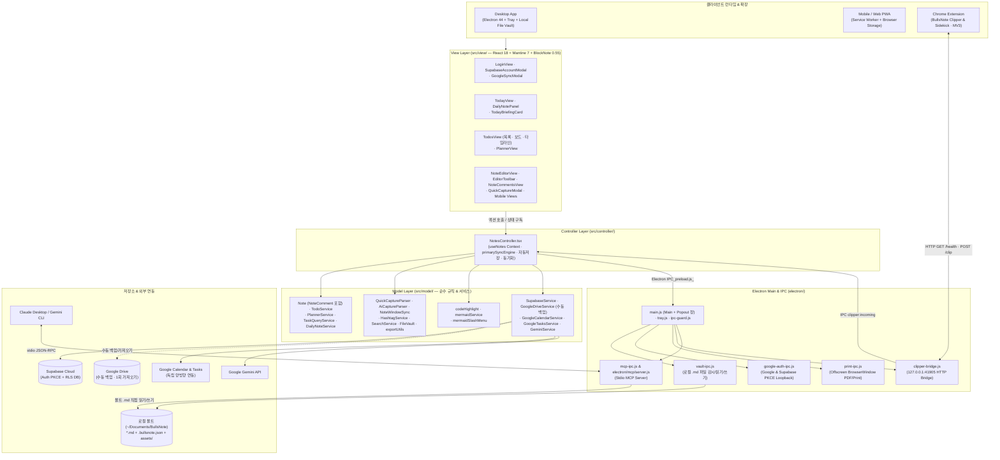
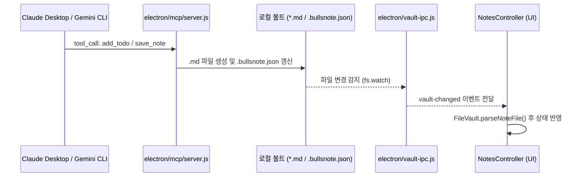
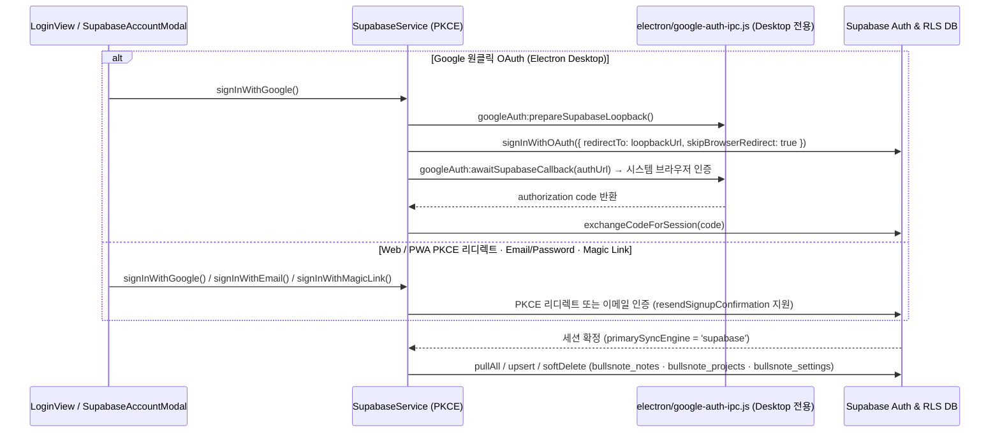
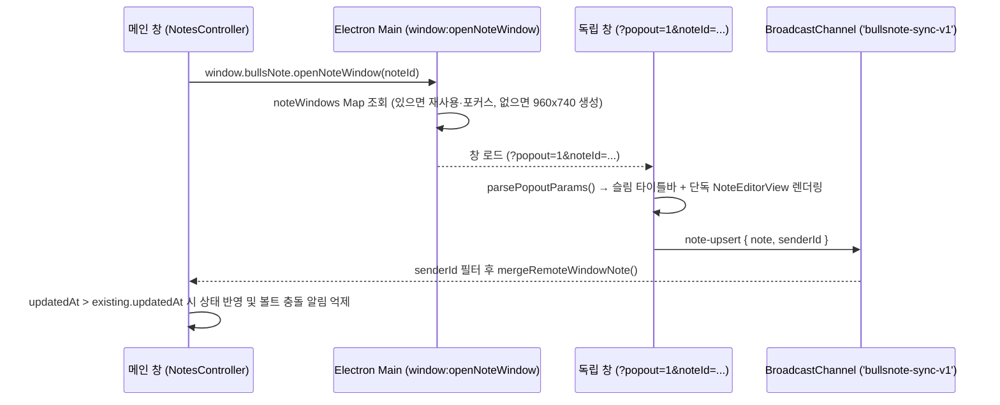
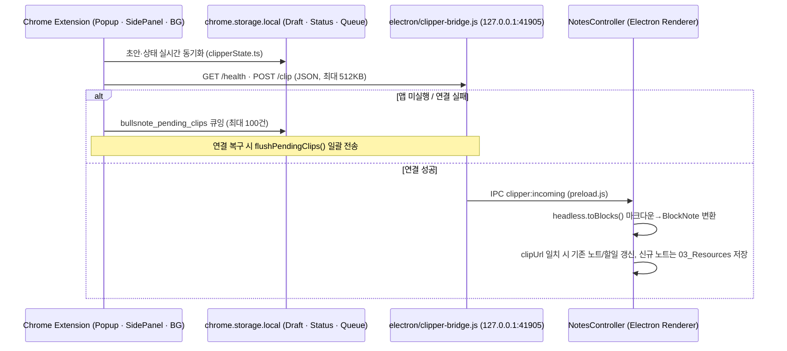
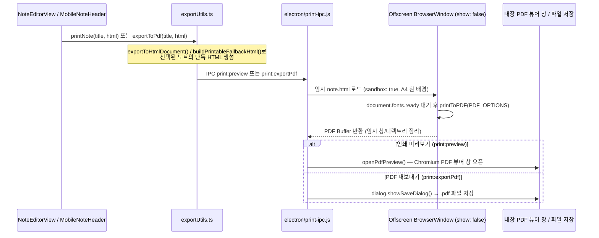

# BullsNote — 아키텍처 설계 문서

이 문서는 BullsNote(v2.0.3 기준)의 전체 시스템 아키텍처, MVC 계층 구조, 데스크톱(Electron) 및 웹(PWA) 듀얼 런타임 구성, 그리고 외부 연동 흐름을 정의합니다.

---

## 1. 핵심 설계 원칙

- **MVC 분리:** 도메인 규칙(`src/model/`)은 UI 프레임워크와 무관한 순수 TypeScript 함수·서비스로 유지하며 Vitest로 검증합니다. 상태 및 유스케이스 조합은 `NotesController`(`src/controller/`)가 담당하고, 화면(`src/view/`)은 컨텍스트를 구독해 렌더링만 수행합니다.
- **로컬 퍼스트 & 단일 클라우드 동기화 (`primarySyncEngine`):** 모든 노트와 할일은 로컬(데스크톱 `.md` 파일 볼트 또는 브라우저 저장소)을 1차 저장소로 사용합니다. 게스트 모드(`'local'`)에서는 로그인 없이 바로 동작하며, 클라우드 동기화 시에는 Supabase(`'supabase'`)를 **단일 기본 동기화 엔진**(`bullsnote_notes` · `bullsnote_projects` · `bullsnote_settings`, RLS 격리)으로 사용해 Google Drive와의 이중 동기화(split-brain)를 제거했습니다. Google Drive는 수동 백업 및 1회 가져오기 용도로 전환되었고, Google Calendar·Google Tasks는 독립 연동으로 유지됩니다.
- **노트-할일 통합 모델:** 할일(Todo)은 별도 DB가 아닌 `Note` 엔티티의 메타데이터(`isTodo`, `todoStatus`, `dueDate`, `startDate`, `reminderAt` 등)로 표현되며, 원 노트의 체크박스와 양방향으로 동기화됩니다.

---

## 2. 전체 시스템 구성도

---

## 3. 계층 및 모듈 상세

| 계층 | 경로 | 책임 |
|---|---|---|
| **Model** | `src/model/` | `SupabaseService`(PKCE Auth·이메일/매직링크/인증 재발송·Google OAuth, `resolvePrimarySyncEngine` 기반 `'supabase' \| 'local'` 결정, `bullsnote_notes`/`bullsnote_projects`/`bullsnote_settings` 증분 병합·업서트·소프트 삭제), `exportUtils`(단독 노트 HTML 생성 `exportToHtmlDocument`·`buildPrintableFallbackHtml`, `printNote`·`exportToPdf` 및 브라우저 `window.print()` 폴백), `Note` 타입/트리/정렬(`NoteComment` 스레드 모델 및 `removeCommentWithReplies` 연쇄 삭제 포함), `NoteWindowSync`(독립 창 쿼리 파싱 `parsePopoutParams`, 타임스탬프 기반 원격 노트 병합 `mergeRemoteWindowNote`, 연쇄 제거 `removeRemoteWindowNote`), `TodoService`(체크리스트 ↔ 할일 양방향 동기화, `TodoStatusLabels` 및 `CustomTodoStatus` 정규화·`localStorage` 영속화·`isBuiltinTodoStatus` 판별), `PlannerService`(근무일·공휴일 기반 기간 계산), `DailyNoteService` & `TodayBriefing`(일일 노트·AI 브리핑), `QuickCaptureParser` & `AiCaptureParser`(자연어 날짜/시각/태그 파싱), `SearchService`(제목·본문·태그·첨부·댓글 통합 검색), `FileVault`(Markdown frontmatter `comments` 포함 직렬화/역직렬화 및 에셋 변환), `mermaidService`(Mermaid 뷰 모드·5종 템플릿·`lintMermaidCode`/`parseMermaidErrorLine` 문법 검증·테마/모양 프리셋 기본값 `redux-color`/`neo` 및 `bullsnote.mermaidPrefs.v1` `localStorage` 영속화·`resolveMermaidTheme` 다크 모드 매핑·`mermaid` 지연 로딩 및 `securityLevel: 'strict'` SVG 렌더러), `mermaidSlashMenu`(`/` 슬래시 메뉴 명령어 생성), `codeHighlight`(`createRichCodeBlock` 기반 `mermaid` 포함 Shiki 코드 강조, Lint 배지/오류 행 하이라이트, 미리보기 전용 SVG 복사/확대/테마·모양 컨트롤 포함 Mermaid 분할 에디터 NodeView) |
| **Controller** | `src/controller/NotesController.tsx` | 앱 전역 상태 관리, `primarySyncEngine: 'supabase' \| 'local'` 단일 클라우드 동기화 오케스트레이션(Supabase Auth·증분 pull/upsert·softDelete), 노트 CRUD 및 히스토리(최대 30개) 스냅샷, 댓글 CRUD·해결 토글(`addComment`, `updateComment`, `deleteComment`, `toggleCommentResolved`), 칸반 상태 이름 및 커스텀 상태 관리(`todoStatusLabels`, `customTodoStatuses`, `todoStatusOrder`, `renameTodoStatus`, `resetTodoStatusLabels`, `addCustomTodoStatus`, `deleteCustomTodoStatus` — 삭제 시 해당 상태 할일을 `'todo'`로 안전 이관 및 `storage` 이벤트 창 간 동기화), `openNoteInNewWindow` 및 `BroadcastChannel('bullsnote-sync-v1')` 기반 창 간 실시간 동기화(`note-upsert`/`note-delete`), 독립 창(`popout`) 모드 시 중복 알람·클라우드 백그라운드 동기화 억제, Chrome Clipper 수신(`window.bullsNote.clipper.onClip` → `03_Resources` 기본 폴더 배치, `clipUrl` 기반 동일 URL 노트·할일 업데이트, `headless.toBlocks` 마크다운→BlockNote 변환), 로컬 볼트 파일 변경 감지 반영, Google Drive 수동 백업/1회 가져오기 및 Google Calendar/Tasks 독립 동기화 오케스트레이션 |
| **View** | `src/view/` | `LoginView`(Google 원클릭 PKCE · 이메일/비밀번호 · 매직링크 · 인증 재발송 · 게스트 모드 · Supabase 연결 설정), `SupabaseAccountModal`(계정 상태 · 수동 동기화 · `primarySyncEngine` 표시), `GoogleSyncModal`(Google Calendar·Tasks 독립 연동 및 Drive 수동 백업·1회 가져오기), `App.tsx` 독립 창(`isPopout`) 슬림 타이틀바·단독 에디터 셸, `TodayView`(오늘 할일·일정·기간 작업·브리핑), `TodosView`(목록·칸반 보드·간트 타임라인, `TaskCard` 드래그 앤 드롭 열 간 상태 변경, 보드 열 상태 이름 인라인 편집·기본 이름 복원 및 커스텀 상태 추가·삭제), `TaskFilterBar`(사용자 지정 상태 이름 및 커스텀 상태 반영 필터 칩), `NoteEditorView`(BlockNote + Shiki 코드 강조 + Mermaid `/` 슬래시 메뉴 통합 + 목차 + 새 창에서 편집 버튼 + 헤더 댓글 포커스 트리거 + 커스텀 상태 메뉴), `EditorToolbar`(Mermaid 다이어그램 삽입 버튼 및 `+` 메뉴 포함 빠른 서식 툴바), `NoteCommentsView`(노트 하단 1단계 스레드형 댓글·답글 패널 및 해결됨/미해결 필터), `NoteListView`(트리 목록, 댓글 수 배지, 커스텀 상태 메뉴 및 `새 창에서 열기` 메뉴), `QuickCaptureModal`, `mobile/` 반응형 레이아웃, `src/index.css`(에디터·Mermaid 분할 뷰·Lint 배지/오류 행 `.is-error-line`·미리보기 컨트롤 및 `@media print` SVG 단독 인쇄 스타일) |
| **Electron Shell** | `electron/` | 단일 인스턴스 락, `noteWindows` Map 기반 독립 창 관리 및 `window:openNoteWindow` IPC(기존 창 재사용/포커스 또는 `?popout=1&noteId=` 새 창 생성, `preload.js`의 `window.bullsNote.openNoteWindow` 노출), `print-ipc.js`(`print:preview` · `print:exportPdf` IPC, 전달된 노트 HTML을 `show: false, sandbox: true` 오프스크린 `BrowserWindow`에서 단독 PDF 렌더링 후 저장 또는 내장 PDF 뷰어 미리보기 창 제공), `clipper-bridge.js`(`127.0.0.1:41905` 로컬 HTTP 브리지, `chrome-extension://*`·`X-BullsNote-Token` 인증, `clipper:incoming` IPC 전달 및 `clipper:getInfo` 노출), 트레이 백그라운드 상주, `ipc-guard.js` 및 `app-origin.js` 기반 IPC/Origin 보안 검증, `vault-ipc.js` 파일시스템 연동, `google-auth-ipc.js`(Google OAuth 및 Supabase `prepareSupabaseLoopback`/`awaitSupabaseCallback` PKCE 루프백 처리) |
| **Supabase Schema** | `supabase/` · `docs/` | `supabase/schema.sql`(`bullsnote_projects`, `bullsnote_notes`, `bullsnote_settings` 테이블, `updated_at` 인덱스, `authenticated` 권한 및 `auth.uid() = user_id` RLS 정책), `docs/SUPABASE_SETUP.md`(프로젝트·OAuth·Redirect URLs·환경 변수 설정 가이드) |
| **Chrome Extension** | `extension/` | **BullsNote Clipper & Sidekick** (Manifest V3): `popup.ts`·`sidepanel.ts`·`background.ts`(우클릭 컨텍스트 메뉴), `clipperState.ts`(`chrome.storage.local` 초안·상태 실시간 동기화), `clipperClient.ts`(`127.0.0.1:41905` 헬스체크/전송 및 `bullsnote_pending_clips` 최대 100건 오프라인 대기열·`flushPendingClips`), `aiHelper.ts`(Chrome 내장 AI `Summarizer`/`LanguageModel` 및 로컬 규칙 폴백 기반 마크다운 요약·`extractKeywordTags` 자동 키워드 태그 추출), `CHROMEWEBSTORE.md`(스토어 등록 정보·권한 근거·Local-First 개인정보 처리방침) |
| **MCP Server** | `electron/mcp/` | 외부 의존성 없는 Node.js stdio MCP 서버 (`save_note`, `list_projects`, `add_todo`, `list_today`). 데스크톱 앱과 동일한 `.md` 볼트 및 `.bullsnote.json` 포맷을 공유 |

---

## 4. 주요 데이터 흐름

### 4-1. 데스크톱 볼트 & 외부 AI(MCP) 공유 구조

### 4-2. Supabase 인증 및 단일 클라우드 동기화 (Desktop ↔ PWA)

- **단일 클라우드 동기화 엔진 (`primarySyncEngine: 'supabase' | 'local'`):** `resolvePrimarySyncEngine()`이 Supabase 세션 유무에 따라 기본 동기화 엔진을 결정합니다. 로그인 상태에서는 Supabase의 3개 RLS 테이블(`bullsnote_notes`, `bullsnote_projects`, `bullsnote_settings`)만 1차 클라우드 저장소로 사용해 Drive와의 이중 동기화(split-brain)를 제거했습니다.
- **Google Drive & Calendar · Tasks 역할 분리:** `GoogleDriveService`는 자동 노트 동기화에서 **수동 백업 및 기존 노트 1회 가져오기**로 전환되었으며, `GoogleCalendarService`(할일 알림 이벤트)와 `GoogleTasksService`(할일 양방향 연동)는 독립 통합으로 유지됩니다.

### 4-3. 노트 댓글 & 하위 답글(스레드) 구조
- **1단계 스레드 모델:** `Note.comments`는 `NoteComment`(`id`, `content`, `author`, `parentId`, `resolved`, `createdAt`, `updatedAt`) 배열로 저장됩니다. `NotesController.addComment`는 하위 답글 작성 시 부모를 `targetParent.parentId || targetParent.id`로 정규화하여 항상 1단계 스레드 구조를 유지합니다.
- **연쇄 삭제 및 잠금 연동:** 루트 댓글 삭제 시 `removeCommentWithReplies()`가 하위 답글을 함께 제거하며, 잠긴 노트에서는 `NoteCommentsView`가 읽기 전용(`disabled`)으로 동작합니다.
- **영속성 및 검색:** 댓글 데이터는 `FileVault`의 `.md` frontmatter(`comments`)와 `NoteRepository`의 `localStorage` 마이그레이션에 함께 저장되며, `SearchService` 검색 인덱싱(초성 검색 포함) 대상에 포함됩니다.

### 4-4. 독립 창(Popout) 및 창 간 실시간 동기화 (`BroadcastChannel`)

- **창 생성 및 수명 주기 (`electron/main.js` · `electron/preload.js`):** `NoteEditorView`(헤더 버튼) 또는 `NoteListView`(`⋯` 메뉴)에서 `openNoteInNewWindow(noteId)`를 호출하면 Electron 환경에서는 `window:openNoteWindow` IPC가 `noteWindows` Map으로 `noteId`당 단일 독립 창을 보장(재사용 또는 신규 생성)하며, 웹/PWA 환경에서는 `window.open(?popout=1&noteId=..., ...)`으로 폴백합니다. 독립 창에서 내부 노트 링크를 클릭하면 메인 창을 포커스해 해당 노트를 열고, 앱 종료 시 `closeAllNoteWindows()`로 모든 독립 창을 함께 정리합니다.
- **실시간 동기화 (`BroadcastChannel('bullsnote-sync-v1')` · `NoteWindowSync.ts`):** 각 창은 고유 `senderId`를 부여받아 자기 자신의 브로드캐스트를 무시합니다. 노트 생성·수정 시 `note-upsert`를 전파해 `mergeRemoteWindowNote()`가 `incoming.updatedAt > existing.updatedAt`인 경우에만 상태를 갱신하고, `lastWrittenRef` 유예 및 `vault-changed` 타임스탬프 비교로 불필요한 파일 감시 충돌 알림을 방지합니다. 노트 삭제 시에는 `note-delete`를 전파해 `removeRemoteWindowNote()`로 대상 및 하위 노트를 함께 제거합니다.
- **백그라운드 작업 격리:** 독립 창(`isPopoutWindow`)에서는 중복 실행을 막기 위해 5초 주기 알람 감지, `<AlarmModal />` 렌더링, Google Drive 자동/초기 동기화, Google Tasks 폴링·업로드를 비활성화하고 메인 창에서만 수행합니다.

### 4-5. Mermaid 다이어그램 에디터 및 실시간 렌더링
- **삽입 경로 (`mermaidSlashMenu.tsx` · `EditorToolbar.tsx` · `codeHighlight.ts`):** `NoteEditorView`의 `/` 슬래시 메뉴(`getMermaidSlashMenuItems`), `EditorToolbar`의 전용 버튼/`+` 메뉴(`insertMermaidDiagram`), 또는 코드 블록 언어 선택기(`mermaid` / `mmd`)로 진입합니다. 삽입 시 `DEFAULT_MERMAID_CODE`(Flowchart 기본 스타터 코드)가 채워지며 기본 뷰 모드는 `DEFAULT_MERMAID_VIEW_MODE = 'split'`(코드 + 실시간 Drawing 분할 에디터)입니다.
- **분할 뷰 및 Shiki 문법 강조 (`codeHighlight.ts` · `mermaidService.ts`):** `SHIKI_LANG_IMPORTS`에 `shiki/langs/mermaid.mjs`를 포함해 `mermaid`/`mmd` 코드에 Shiki 문법 강조를 적용합니다. `createRichCodeBlock` NodeView 내부에서 `split`(에디터)·`preview`(다이어그램)·`code`(코드) 모드 전환을 지원하며 블록별 뷰/테마/모양 상태를 `codeBlockStateCache`로 보존합니다. `preview` 모드에서 다이어그램을 더블클릭하면 `split` 모드로 전환되고, 툴바의 템플릿 드롭다운(`MERMAID_TEMPLATES`)으로 Flowchart · Sequence · ERD · Gantt · Mindmap 5종을 즉시 교체할 수 있습니다.
- **실시간 문법 Lint & 지연 로딩 렌더링 (`mermaidService.ts` · `codeHighlight.ts`):** 250ms 디바운스로 `lintMermaidCode()`(`mermaid.parse`, `securityLevel: 'strict'`)를 선행 실행해 툴바 상태 배지(`✓ 구문 정상` / `⚠ N행 오류`)를 갱신하고, `parseMermaidErrorLine()`으로 추출한 오류 행을 줄 번호 거터(`.is-error-line`)에 하이라이트합니다. 구문 통과 시 `renderMermaidSvg()`가 `import('mermaid')`로 라이브러리를 지연 로딩해 SVG를 렌더링하며, 문법 오류 발생 시에는 마지막 정상 SVG(`lastValidSvg`)를 유지한 채 하단에 오류 메시지를 표시합니다.
- **테마/모양 프리셋 & `localStorage` 영속화 (`mermaidService.ts`):** 기본값은 `DEFAULT_MERMAID_THEME = 'redux-color'`와 `DEFAULT_MERMAID_LOOK = 'neo'`이며, 테마 6종(`redux-color`·`redux`·`neo`·`default`·`forest`·`neutral`) 및 모양 3종(`neo`·`classic`·`handDrawn`)을 지원합니다. `resolveMermaidTheme()`가 `data-mantine-color-scheme` 변화(`MutationObserver`)에 맞춰 다크/라이트 테마(`redux-dark-color`, `redux-dark`, `neo-dark`, `dark`)를 자동 매핑하며, 사용자 선택값은 `bullsnote.mermaidPrefs.v1`(`localStorage`)에 저장(`loadMermaidPrefs`/`saveMermaidPrefs`)됩니다.
- **미리보기 전용 컨트롤 & 인쇄 (`codeHighlight.ts` · `index.css`):** 테마·모양 선택, 인라인 줌/리셋(`-` · `100%` · `+`) 및 드래그 패닝, `SVG 복사`, `확대` 모달(25%~300% 줌 · `SVG 다운로드`)을 미리보기 영역(`.bn-mermaid-preview-controls`)에만 배치해 코드 보기에서는 노출되지 않도록 분리했습니다. `@media print` 규칙에서는 `.bn-code-toolbar`, `.bn-mermaid-code-pane`, `pre`, `.bn-mermaid-error`를 숨겨 인쇄 시 렌더링된 SVG 다이어그램만 출력되도록 처리합니다.

### 4-6. Chrome Clipper & 로컬 브리지(`127.0.0.1:41905`) 연동

- **로컬 HTTP 브리지 (`electron/clipper-bridge.js`):** 루프백(`127.0.0.1:41905`, 포트 사용 중 시 동적 포트 폴백)에서 `GET /health`와 `POST /clip`을 제공합니다. `chrome-extension://*` Origin 또는 `X-BullsNote-Token`(`userData/clipper-token`)으로 요청을 인가하며, `validateClipPayload()`로 512KB 본문 제한과 `mode`(`note` | `todo` | `daily`)·태그·URL을 정규화한 뒤 `mainWindow.webContents.send('clipper:incoming', payload)`로 전달합니다.
- **확장프로그램 동기화 · AI · 오프라인 큐 (`extension/src/`):** `clipperState.ts`가 초안(`bullsnote_clipper_draft`)과 상태(`bullsnote_clipper_status`)를 `chrome.storage.local`에 동기화해 Popup과 Side Panel 간 실시간 연동을 유지합니다. `aiHelper.ts`는 외부 API 전송 없이 Chrome 내장 AI(`Summarizer` / `LanguageModel`) 또는 로컬 규칙 폴백으로 마크다운 요약과 핵심 키워드 태그(`extractKeywordTags`)를 생성하며, 앱이 종료된 상태에서는 `clipperClient.ts`가 `bullsnote_pending_clips`에 최대 100건까지 보관했다가 연결 복구 시 `flushPendingClips()`로 전송합니다.
- **수신 및 변환 (`NotesController.tsx`):** `mode === 'note'` 수신 시 `headless.toBlocks()`로 마크다운을 BlockNote 블록 JSON으로 변환합니다. `updateExisting !== false`이고 `clipUrl`이 일치하는 기존 노트가 있으면 본문·태그를 갱신하며, 신규 노트는 `03_Resources` 폴더(없으면 기본 폴더)에 생성하고 `queueNoteSync` 및 `broadcastNoteUpsert`로 볼트·창 간 동기화를 수행합니다. (권한 근거 및 Local-First 정책은 `extension/CHROMEWEBSTORE.md` 참조)

### 4-7. 오프스크린 HTML → PDF 저장 및 인쇄 미리보기 (`exportUtils.ts` · `electron/print-ipc.js`)

- **노트 목록 인쇄 차단:** 메인 창 DOM을 직접 인쇄하지 않고, `exportToHtmlDocument()`가 생성한 선택 노트 단독 HTML만 오프스크린 `BrowserWindow`(`show: false`, `contextIsolation: true`, `sandbox: true`)에 로드해 `printToPDF(PDF_OPTIONS)`를 실행하므로 사이드바나 노트 목록이 출력물에 포함되지 않습니다.
- **단일 PDF 파이프라인 & 웹 폴백:** 인쇄 미리보기(`print:preview`)와 PDF 저장(`print:exportPdf`)이 동일한 `renderPdf()` 로직을 공유하며, 브라우저/PWA 환경에서는 `window.print()`로 폴백합니다.
