# BullsNote

**노트와 할일을 한곳에.** 생각은 노트로 적고, 해야 할 일은 할일로 꺼내고, 하루는 "오늘" 화면에서 한눈에 봅니다.

Windows · macOS · Linux 데스크톱 앱과 iPhone · iPad · Android에서 설치해 쓰는 웹 앱(PWA)을 지원합니다.

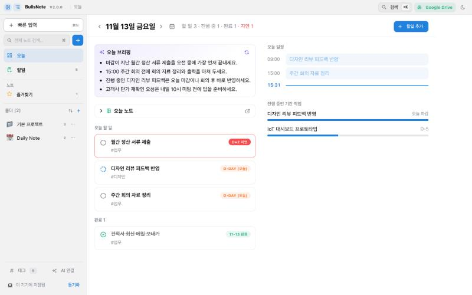

- **버전:** 2.0.0
- **플랫폼:** Windows · macOS · Linux · PWA
- **스택:** Electron, React 18, TypeScript, Vite

---

## 목차

- [소개](#소개)
- [주요 기능](#주요-기능)
- [단축키](#단축키)
- [데이터는 어디에 저장되나요](#데이터는-어디에-저장되나요)
- [빌드 가이드](#빌드-가이드)
- [모바일에서 쓰기 (PWA)](#모바일에서-쓰기-pwa)
- [AI 연결 (Gemini · MCP)](#ai-연결-gemini--mcp)
- [프로젝트 구조](#프로젝트-구조)
- [문제 해결](#문제-해결)
- [라이선스](#라이선스)

---

## 소개

BullsNote는 **노트와 할일, 두 기둥**으로 이루어진 개인 지식관리 앱입니다.

| 원칙 | 의미 |
|---|---|
| 노트와 할일이 이어져 있다 | 노트 속 체크리스트를 바로 할일로 만들고, 할일을 완료하면 원래 노트의 체크박스도 함께 체크됩니다. |
| 일정은 할일을 보여주는 방법이다 | 따로 일정을 관리하지 않습니다. 할일의 마감일과 기간이 목록·보드·타임라인에서 서로 다른 모양으로 보입니다. |
| 로그인 없이 바로 시작한다 | 설치하고 "바로 시작하기"를 누르면 끝입니다. 다른 기기와 쓰고 싶을 때만 Google 계정을 연결합니다. |
| 데이터는 내 것이다 | 노트는 내 기기와 내 Google Drive에만 저장됩니다. 별도 서버가 없습니다. |

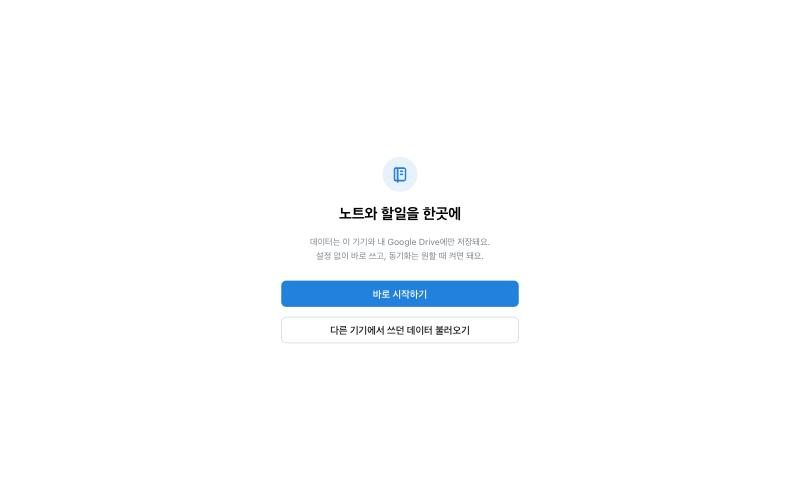

---

## 주요 기능

### 오늘 — 하루를 한 화면에

앱을 열면 가장 먼저 보이는 화면입니다.

- **오늘 할 일:** 마감이 지난 할일, 오늘 마감인 할일, 진행 중인 할일을 모아 보여줍니다. 그날 완료한 일은 아래 "완료" 묶음에 남습니다.
- **오늘 일정:** 알림 시각이 있는 할일을 시간 순서로 보여주고, 지금 시각을 선으로 표시합니다.
- **진행 중인 기간 작업:** 여러 날에 걸친 작업이 얼마나 지났는지 막대로 보여줍니다.
- **날짜 이동:** ‹ › 버튼과 달력으로 어제나 내일, 원하는 날짜로 옮겨 볼 수 있습니다.
- **오늘 브리핑 (AI):** 버튼을 누르면 할 일·일정·오늘 노트를 3~4줄로 요약합니다. 요약은 그날 노트에 저장됩니다.

### 오늘 노트 (Daily Note) — 하루 계획표

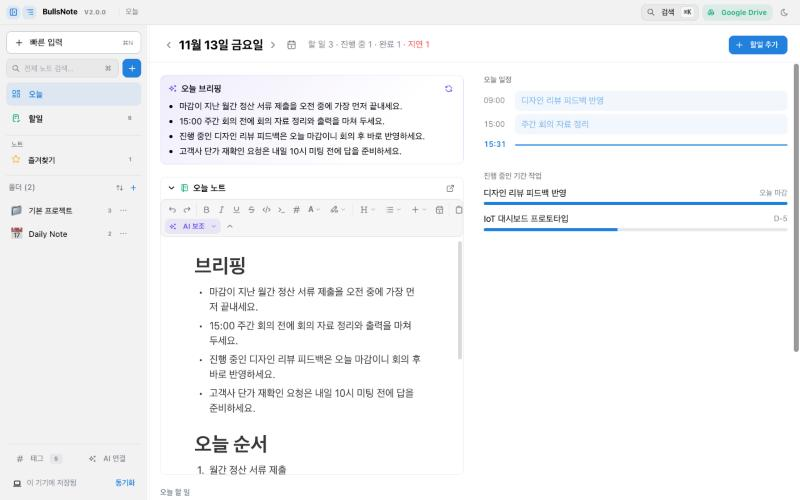

- 날짜별로 노트가 하나씩 만들어집니다. 오늘 화면에서 바로 편집할 수 있습니다.
- 템플릿은 "오늘 순서 · 주의할 점 · 메모" 세 칸입니다. "오늘 순서"에는 그날 할 일이 미리 채워집니다.
- 빠른 입력에서 "오늘 노트"를 고르면 메모 칸에 `HH:MM 내용` 한 줄이 붙습니다.

### 빠른 입력 — 한 줄로 할일 만들기 (`⌘N` / `Ctrl+N`)

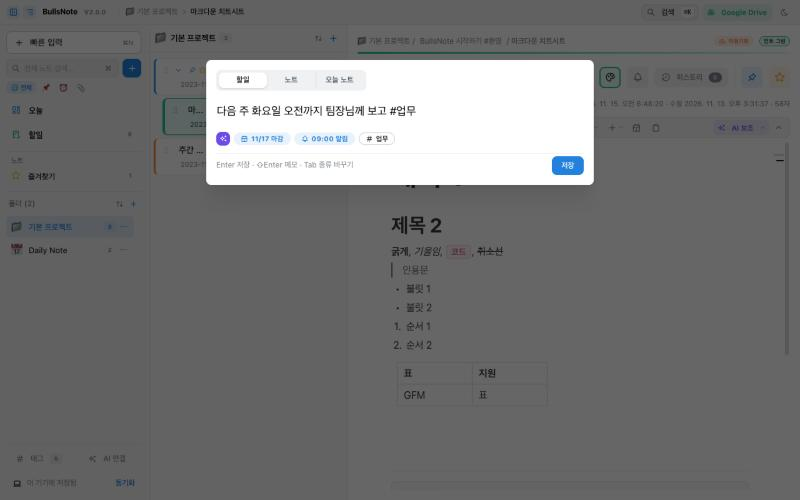

`내일 3시 견적서 회신 #업무`처럼 쓰면 날짜·시각·태그를 알아서 읽습니다.

| 이렇게 쓰면 | 이렇게 읽어요 |
|---|---|
| 오늘 · 내일 · 모레 · 글피 | 마감일 |
| 11/20 · 11월 20일 · 금요일 · 3일 후 | 마감일 |
| 3시 · 오후 2시 반 · 14:30 | 알림 시각 (오전·오후 없이 1~7시는 오후로 봄) |
| #업무 | 태그 |

- 날짜가 있으면 할일로, 없으면 노트로 저장됩니다. `Tab`으로 할일 · 노트 · 오늘 노트를 바꿀 수 있습니다.
- **AI로 해석 (✨):** "다음 주 화요일 오전까지"처럼 규칙으로 읽기 어려운 문장은 Gemini가 다시 읽습니다. 결과가 이상하면 버리고 기존 해석을 그대로 씁니다.
- **클립보드 가져오기 (`⌘J` / `Ctrl+J`):** 클립보드의 글을 가져와 노트로 저장합니다. 긴 글은 AI로 요약할 수 있습니다.

### 할일 — 목록 · 보드 · 타임라인

같은 할일을 세 가지 모양으로 봅니다. 상태(대기 · 진행 중 · 완료 · 중단), 기간, 폴더, 태그로 거를 수 있습니다.

| 목록 | 보드 |
|---|---|
| 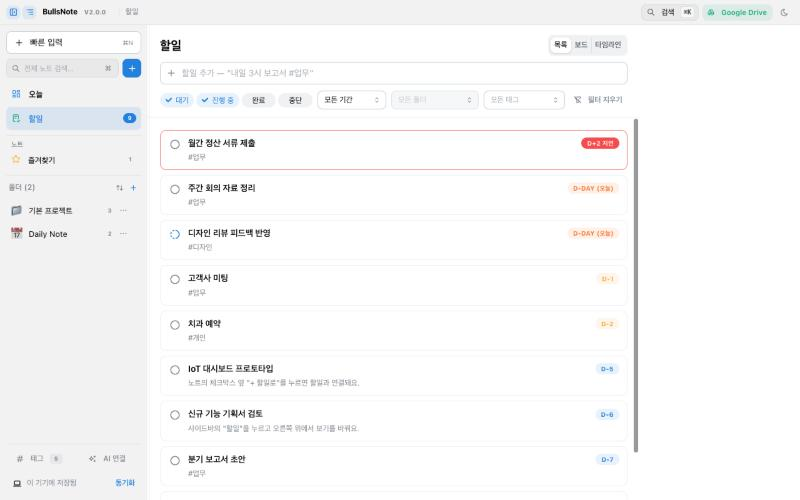 | 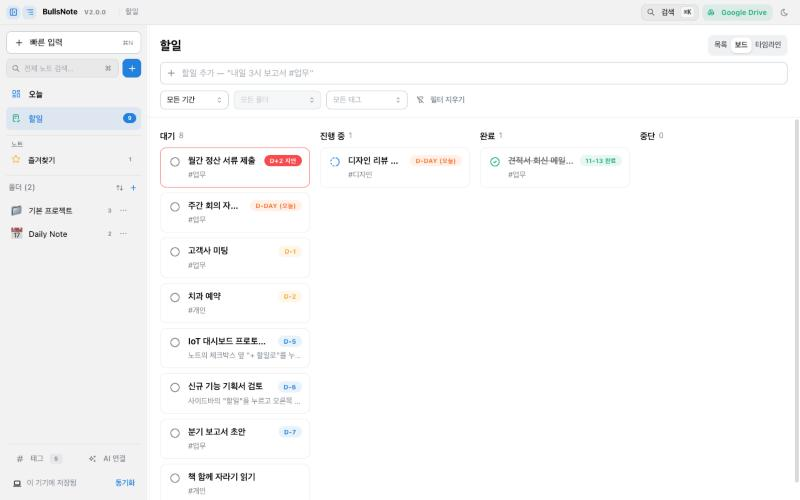 |

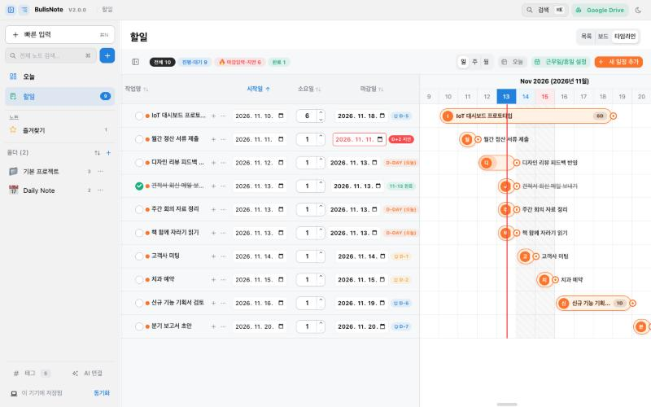

- **목록:** 미완료 할일이 마감일이 빠른 순서로 보입니다. 맨 위 입력칸에서 바로 추가할 수 있습니다.
- **보드:** 상태별 칸반입니다. 카드를 누르면 상세 창이 열리고, 거기서 상태와 날짜를 바꿉니다.
- **타임라인:** 할일 기간을 막대로 보는 간트 차트입니다. 근무일(주말·공휴일 제외)로 기간을 계산할 수 있습니다.
- **체크리스트 연결:** 노트의 체크리스트 항목 옆 "+ 할일로"를 누르면 할일이 만들어지고, 두 체크 상태가 서로 따라갑니다.

### 노트 — 블록 에디터

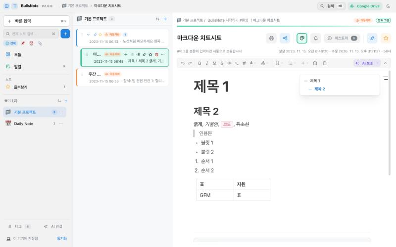

- **블록 에디터:** Notion처럼 `/`로 표·코드·이미지·파일을 넣고, 블록을 끌어서 순서를 바꿉니다.
- **코드 블록:** 19개 언어의 문법을 강조합니다.
- **날짜 넣기:** `@오늘`, `@내일`처럼 쓰면 날짜가 들어갑니다.
- **목차:** 오른쪽 가장자리의 얇은 막대에 마우스를 올리면(모바일은 탭) 제목 목록이 펼쳐집니다. 본문을 가리지 않습니다.
- **정리:** 폴더 · 하위 노트(트리) · 고정 · 즐겨찾기 · 7가지 색상 라벨로 정리합니다. 본문의 `#태그`는 자동으로 모입니다.
- **편집 히스토리:** 최대 30개까지 자동으로 저장하고, 한 번에 되돌릴 수 있습니다.
- **내보내기:** 인쇄, PDF 저장, 마크다운·HTML·일반 텍스트로 복사하거나 파일로 저장할 수 있습니다.

### 알림 · Google Calendar

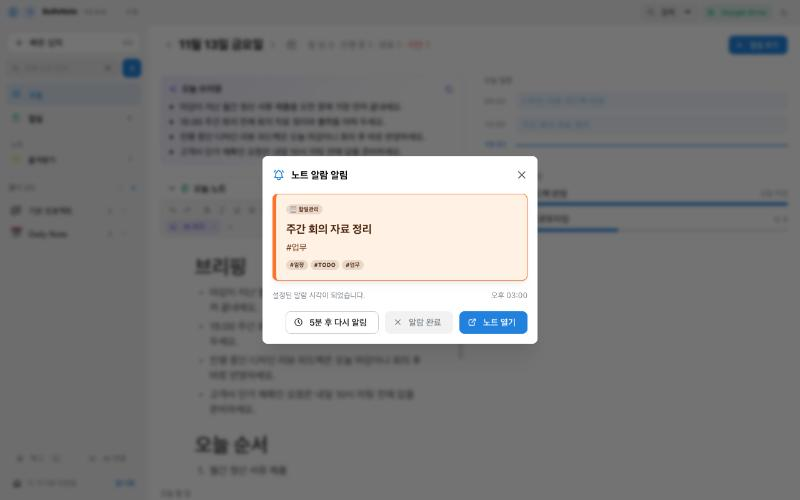

- **알림 시각:** 날짜·시각을 정하고 반복(매일 · 평일 · 매주 · 매월)을 고를 수 있습니다.
- **마감일 알림:** 마감일만 정한 할일은 그날 09:00에 알려줍니다.
- **Google Calendar 연동:** Google 계정을 연결하면 알림이 캘린더에도 등록됩니다. 그러면 휴대폰에서도 10분 전과 정각에 알림을 받습니다.

### 동기화 — Google Drive

- **저장 위치:** 사이드바 아래 "동기화"에서 "Google로 계속"을 누르면 내 Google Drive에 노트와 첨부파일이 저장됩니다.
- **다른 기기 연결:** 다른 기기에서는 QR 코드나 연동 코드(`BNM1:…`)로 바로 이어서 쓸 수 있습니다.
- **증분 동기화:** 바뀐 노트만 주고받습니다.

### 모바일

| 노트 목록 | 노트 편집 |
|---|---|
| 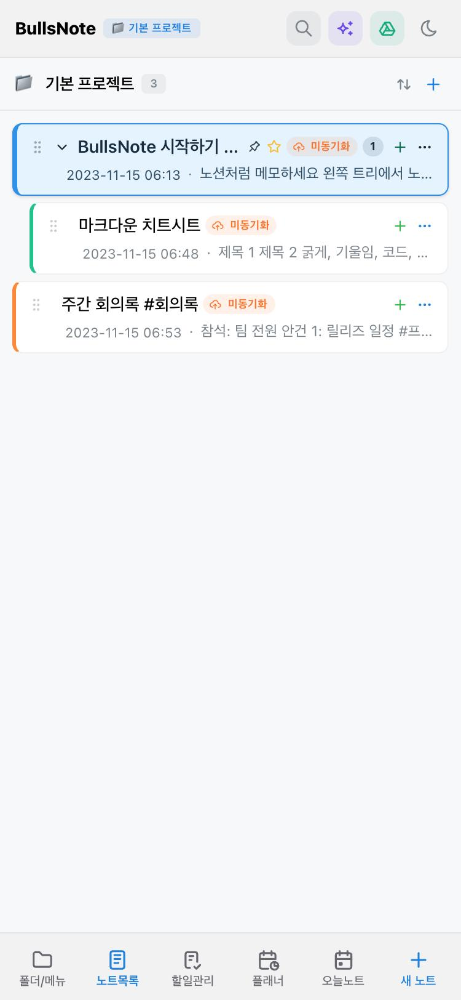 | 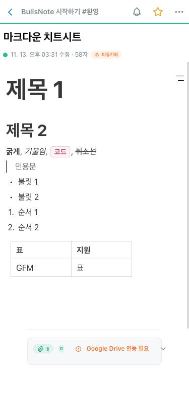 |

- **휴대폰:** 한 화면에 하나씩 보여주고, 아래 탭(폴더 · 노트목록 · 할일관리 · 플래너 · 오늘노트 · 새 노트)으로 이동합니다.
- **태블릿:** 목록과 에디터를 두 칸으로 보여줍니다.
- **노트 편집:** 위쪽 막대 하나에 주요 버튼만 두고, 나머지는 `⋯` 메뉴로 옮겼습니다. 아래로 스크롤하면 제목 영역이 접힙니다.

---

## 단축키

| 동작 | macOS | Windows · Linux |
|---|---|---|
| 빠른 입력 | `⌘N` | `Ctrl+N` |
| 검색 | `⌘K` | `Ctrl+K` |
| 클립보드로 빠른 입력 | `⌘J` | `Ctrl+J` |
| 인쇄 | `⌘P` | `Ctrl+P` |
| 빠른 입력에서 종류 바꾸기 | `Tab` | `Tab` |
| 빠른 입력에서 메모 추가 | `⇧Enter` | `Shift+Enter` |

---

## 데이터는 어디에 저장되나요

| 환경 | 저장 위치 |
|---|---|
| 데스크톱 앱 | `문서/BullsNote` 폴더에 노트 한 개당 `.md` 파일 한 개로 저장됩니다. 맨 위 frontmatter에 정보가 들어가고 본문은 Markdown입니다. 다른 편집기로 고친 내용도 앱이 감지해 다시 읽습니다. 저장 폴더는 사이드바에서 바꿀 수 있습니다. |
| 웹 · PWA | 브라우저 저장소에 저장됩니다. |
| Google Drive (선택) | 위 저장 위치와 별도로, 내 Drive에 노트와 첨부파일을 동기화합니다. |

---

## 빌드 가이드

### 준비물

| 항목 | 버전 |
|---|---|
| Node.js | 22 이상 (CI와 같은 버전) |
| npm | Node.js에 포함된 버전 |
| macOS용 빌드 | macOS 필요 |
| Linux용 빌드 | Linux 또는 WSL2 권장 |

### 설치

```bash
git clone https://github.com/bullseye73/bullsNote.git
```

```bash
cd bullsNote && npm install
```

### 개발 실행

| 명령 | 하는 일 |
|---|---|
| `npm run dev` | Vite 개발 서버(5190 포트)와 Electron 데스크톱 앱을 함께 실행 |
| `npm run dev:browser` | 브라우저용 개발 서버만 실행 (같은 Wi-Fi의 휴대폰에서 `http://<PC IP>:5190`으로 접속 가능) |
| `npm test` | 단위 테스트(Vitest) 실행 |
| `npm run build` | 타입 검사 후 웹 빌드 (`dist/`) |

### 데스크톱 설치 파일 만들기

```bash
npm run dist
```

현재 OS용 설치 파일이 `release/` 폴더에 만들어집니다. 특정 OS용은 `npm run dist:win`, `npm run dist:mac`, `npm run dist:linux`로 만듭니다.

| OS | 결과물 |
|---|---|
| Windows | NSIS 설치 파일, 포터블 실행 파일 |
| macOS | `.dmg`, `.zip` |
| Linux | `.AppImage`, `.deb` |

### 환경 변수 (선택)

"Google로 계속" 버튼으로 바로 로그인하려면 앱에 들어갈 Google OAuth 클라이언트가 필요합니다. 프로젝트 루트에 `.env.local` 파일을 만들고 아래 값을 넣으세요. 이 파일은 Git에 올리지 않습니다.

```
VITE_GOOGLE_CLIENT_ID=<Google Cloud OAuth 클라이언트 ID>
VITE_GOOGLE_CLIENT_SECRET=<데스크톱 앱 클라이언트 보안 비밀>
```

값이 없어도 앱은 동작합니다. 이때는 동기화 창의 "고급" 메뉴에서 사용자가 직접 클라이언트 ID를 넣어야 합니다.

### 릴리스 (GitHub Actions)

`v`로 시작하는 태그를 올리면 `.github/workflows/release.yml`이 세 OS용 설치 파일을 만들어 GitHub Release에 올립니다.

```bash
npm version minor
```

```bash
git push origin main --tags
```

> 저장소의 **Settings → Actions → General → Workflow permissions**를 "Read and write"로 바꿔 두어야 Release에 파일이 올라갑니다.

---

## 모바일에서 쓰기 (PWA)

`main` 브랜치에 푸시하면 `.github/workflows/deploy-pwa.yml`이 GitHub Pages에 웹 앱을 배포합니다. 처음 한 번은 저장소의 **Settings → Pages → Source**를 "GitHub Actions"로 바꿔 주세요.

- **iPhone · iPad (Safari):** 배포 주소에 접속한 뒤 공유 → **홈 화면에 추가**를 누릅니다.
- **Android (Chrome):** 배포 주소에 접속한 뒤 메뉴(`⋮`) → **앱 설치**를 누릅니다.

홈 화면 아이콘으로 열면 주소창 없이 앱처럼 실행됩니다. PC와 같은 데이터를 쓰려면 PC 앱의 동기화 창에 있는 QR 코드나 연동 코드로 연결하세요.

---

## AI 연결 (Gemini · MCP)

AI 기능은 모두 선택 사항이며, 켜지 않아도 앱의 모든 기본 기능을 쓸 수 있습니다.

### Gemini (앱 안에서 쓰는 AI)

사이드바 아래 **AI 연결**에서 개인 Gemini API 키를 넣으면 켜집니다. 키는 내 기기에만 저장됩니다.

- **에디터:** `/` 메뉴와 "AI 보조"로 요약, 다듬기, 이어 쓰기를 합니다.
- **오늘 브리핑:** 할 일·일정·오늘 노트를 3~4줄로 요약합니다.
- **빠른 입력:** ✨ 버튼으로 날짜·시각을 AI가 다시 읽습니다.
- **클립보드 정리:** 긴 글을 요약해서 노트로 저장합니다.

AI는 버튼을 누를 때만 호출됩니다.

### MCP (Claude Desktop · Gemini CLI에서 BullsNote 쓰기, 데스크톱 전용)

사이드바 저장 폴더 옆의 🔌 버튼을 누르면 Claude Desktop이나 Gemini CLI에 BullsNote MCP 서버가 등록됩니다. 사용자 PC에 Node.js가 없어도 됩니다.

| 도구 | 하는 일 |
|---|---|
| `save_note` | 대화 내용을 노트로 저장 (기본 위치: "AI 노트" 폴더) |
| `list_projects` | 폴더 목록 확인 |
| `add_todo` | 할일 추가 (마감일 · 알림 시각 · 메모) |
| `list_today` | 오늘 할 일 · 오늘 완료한 일 · 오늘 일정 조회 |

예: Claude에게 "내일 오후 3시에 보고서 회신 할일 추가해줘"라고 말하면 BullsNote 할일에 바로 들어갑니다.

---

## 프로젝트 구조

MVC 구조입니다. 규칙(model)은 화면과 분리된 순수 함수로 두고, 단위 테스트로 검증합니다.

```
src/
  model/        규칙과 저장 — 노트·할일·플래너 규칙, 빠른 입력 해석, Daily Note,
                오늘 브리핑, Google Drive·Calendar 동기화, 파일 볼트 형식
    __tests__/  Vitest 단위 테스트
  controller/   NotesController.tsx — 앱 상태와 동작 (useNotes 컨텍스트)
  view/         화면 — 오늘, 할일(목록·보드·타임라인), 노트 에디터, 사이드바, 모바일 화면
electron/       데스크톱 셸 — 창, 트레이, 저장 폴더, Google 로그인, MCP 등록
  mcp/          MCP 서버 (의존성 없는 stdio 서버)
public/         PWA 매니페스트, 서비스 워커, 아이콘
docs/           설계 문서와 README 이미지
```

| 영역 | 사용 기술 |
|---|---|
| 앱 | Electron 44, React 18, TypeScript, Vite 5 |
| UI | Mantine 7, Tabler Icons |
| 에디터 | BlockNote 0.55, Shiki (코드 강조) |
| 테스트 | Vitest |

---

## 문제 해결

- **macOS에서 "손상되었기 때문에 열 수 없습니다"가 뜰 때:** Apple 공증을 받지 않은 앱이라 생기는 경고이고, 파일이 손상된 것은 아닙니다. 앱을 `응용 프로그램` 폴더로 옮긴 뒤 아래 명령을 실행하세요.

  ```bash
  xattr -cr /Applications/BullsNote.app
  ```

- **Windows에서 NSIS 오류가 날 때:** `%LOCALAPPDATA%\electron-builder\Cache\nsis` 폴더를 지우고 다시 빌드하세요.
- **Electron 다운로드가 실패할 때:** `npm install --ignore-scripts`로 설치한 뒤 `node node_modules/electron/install.js`를 따로 실행하세요.
- **AI·Drive 통신이 막힐 때:** `index.html`의 CSP(`connect-src`)에 해당 주소가 허용되어 있는지 확인하세요.

---

## 라이선스

이 프로젝트의 라이선스는 아직 정해지지 않았습니다.

이 앱은 오픈소스 라이브러리를 사용합니다. 대부분 MIT · ISC · BSD · Apache-2.0 라이선스입니다. 블록 에디터인 [BlockNote](https://github.com/TypeCellOS/BlockNote)(`@blocknote/core`, `@blocknote/react`, `@blocknote/ariakit`)는 **MPL-2.0** 라이선스입니다.
